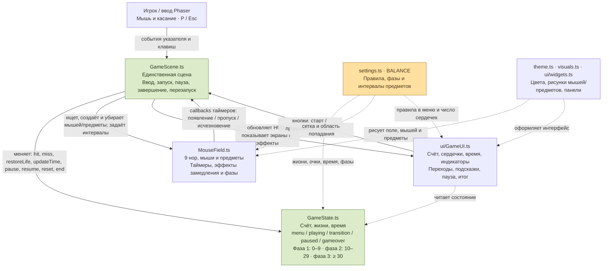

# Архитектура игры «Бей мышей» — как есть

Схема проверена по текущему коду 11 ноября 2026 года. Сплошные стрелки показывают вызовы и действия, пунктирные — чтение данных или использование настроек/графики.

## Что важно объяснить по схеме

- **Запуск:** `main.ts` вызывает `createGame()` из `game/config.ts`; Phaser создаёт одну сцену `GameScene`.
- **Игрок:** отдельного класса `Player` и управляемого персонажа нет. Игрок нажимает мышью или касанием на мышек; P/Esc переключают паузу.
- **Попадание:** `GameScene` сначала проверяет предмет через `MouseField.findItem()`, затем мышь через `findMouse()`. Подбор предмета не обрабатывается как попадание/промах. Для мыши `GameState.hit()` начисляет очки; нора освобождается сразу, поэтому повторное попадание не засчитывается.
- **Система фаз:** отдельного класса `Phase` нет. Фаза хранится в `GameState.gameStage`: 1 до 9, 2 от 10 до 29, 3 от 30 очков текущей партии. `hit()` возвращает следующую фазу при первом достижении её порога. Обе фазы перехода используют 1200 мс передышки, при которой спавн и игровой таймер остановлены, а поле очищается без штрафа. Фаза 3 сохраняет темп и вероятности мышей фазы 2.
- **Полезные предметы:** только фаза 3 вызывает один таймер предложения. Предмет создаётся в свободной норе и исключает её из выбора мышей; занятое поле вызывает повтор через 500 мс. Сыр временно масштабирует уже активные таймеры мышей и появления; таймер партии не меняется. Phaser Clock останавливает таймеры предметов и замедления на паузе.
- **Таймеры:** `MouseField` создаёт Phaser Clock-события `addEvent()` / `delayedCall()`. Их callbacks возвращают управление в `GameScene`: создать мышь или обработать пропуск. Отсчёт всей партии хранит `GameState`, сцена передаёт ему `performance.now()`.
- **Пауза:** сцена меняет состояние через `GameState.pause()`, останавливает Phaser Clock и текущие Tween-анимации, показывает экран паузы. `resume()` исключает время паузы из отсчёта партии.
- **Результат и перезапуск:** при нуле жизней или времени сцена вызывает `GameState.end()`, очищает поле и показывает итог. Кнопка «Заново» вызывает `scene.restart()`; затем `create()` сбрасывает состояние через `GameState.reset()`. Возвращаются фаза 1, 0 очков, 5 жизней и 90 секунд.

`GameState` не зависит от Phaser. `GameUI` читает состояние, но не начисляет очки. `MouseField` управляет объектами и таймерами, но решение об изменении счёта и жизней остаётся в `GameState`, вызываемом сценой.

Показаны основные связи, а не все импорты: например, `GameScene` также использует `BALANCE.hitPoints` и `COLORS` для всплывающего «+1». Общие элементы оформления используются и полем, и интерфейсом.