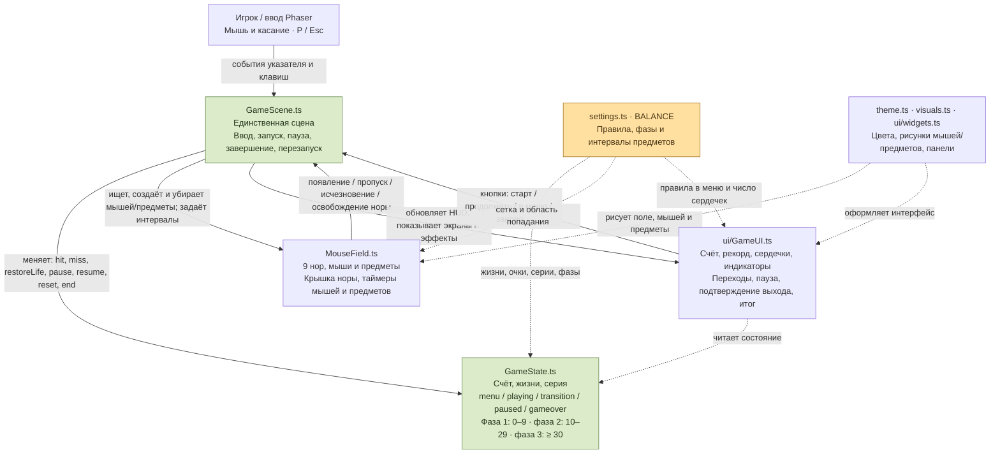

# Архитектура игры «Бей мышей» — как есть

Сплошные стрелки показывают вызовы и действия, пунктирные — чтение данных или использование настроек и графики.

## Что важно объяснить по схеме

- **Запуск:** `main.ts` вызывает `createGame()` из `game/config.ts`; Phaser создаёт одну сцену `GameScene`.
- **Игрок:** отдельного класса `Player` и управляемого персонажа нет. Игрок нажимает мышью или касанием на мышек; P/Esc переключают паузу.
- **Попадание.** `GameScene` игнорирует нажатие на закрытую нору. Для остальных нажатий сцена сначала проверяет предмет через `MouseField.findItem()`, затем мышь через `findMouse()`. При попадании по обычной мыши `GameState.hit()` начисляет очки, а нора освобождается сразу.
- **Система фаз.** Фаза хранится в `GameState.gameStage`: 1 до 9, 2 от 10 до 29, 3 от 30 очков текущей партии. `hit()` возвращает следующую фазу при первом достижении её порога. Переход на 1200 мс останавливает появление мышей и очищает поле без штрафа. Фаза 3 сохраняет темп и вероятности мышей фазы 2.
- **Полезные предметы и сыр.** Только фаза 3 запускает таймер предложения предмета. При заполненном поле этот таймер повторяет попытку через 500 мс. Сыр закрывает случайную нору на 10 секунд. `MouseField` исключает её из выбора для мышей и предметов, а `GameScene` хранит ожидание свободной норы и таймер блокировки. На паузе Phaser Clock останавливает отсчёт. После открытия норы сцена запускает обычный интервал до следующего предмета.
- **Таймеры.** `MouseField` создаёт события Phaser Clock для появления и исчезновения мышей и предметов. Обработчики появления и пропуска передают управление в `GameScene`. Сцена также использует Phaser Clock для переходов и блокировки норы.
- **Пауза.** Сцена останавливает Phaser Clock и текущие анимации. При отмене выхода или обычном продолжении `GameState.resume()` возвращает состояние игры или перехода.
- **Результат и перезапуск.** При нуле жизней `GameState.end()` один раз переводит партию в `gameover`. Сцена отменяет таймеры, очищает поле, сохраняет общий счёт и открывает результат. «Заново» начинает партию с фазы 1, нулевого счёта и пяти жизней. Подтверждённый выход в меню прерывает партию без начисления общих очков.

`GameState` не зависит от Phaser. `GameUI` читает состояние, но не начисляет очки. `MouseField` управляет объектами и таймерами, но решение об изменении счёта и жизней остаётся в `GameState`, вызываемом сценой.

Показаны основные связи, а не все импорты: например, `GameScene` также использует `BALANCE.hitPoints` и `COLORS` для всплывающего «+1». Общие элементы оформления используются и полем, и интерфейсом.
