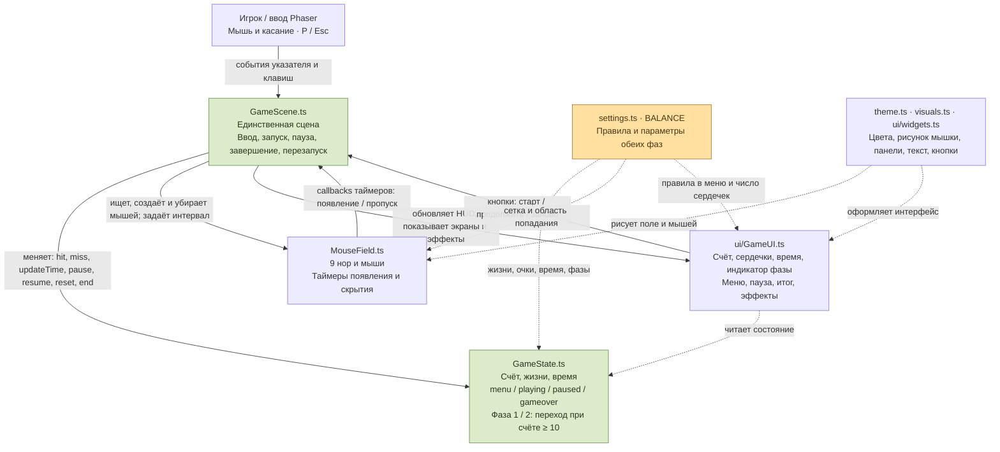

# Архитектура игры «Бей мышей» — как есть

Схема проверена по текущему коду 28 октября 2026 года. Сплошные стрелки показывают вызовы и действия, пунктирные — чтение данных или использование настроек/графики.

## Что важно объяснить по схеме

- **Запуск:** `main.ts` вызывает `createGame()` из `game/config.ts`; Phaser создаёт одну сцену `GameScene`.
- **Игрок:** отдельного класса `Player` и управляемого персонажа нет. Игрок нажимает мышью или касанием на мышек; P/Esc переключают паузу.
- **Попадание:** `GameScene` находит мышь через `MouseField.findMouse()`, вызывает `GameState.hit()`, обновляет интерфейс и убирает мышь через `MouseField.clearMouse()`. Поле сразу помечает нору свободной, поэтому повторное попадание не даёт очков.
- **Система фаз:** отдельного класса `Phase` нет. Фаза хранится в `GameState.gameStage`. При счёте от 10 `hit()` один раз сообщает о переходе. Сцена меняет интервал появления с 1200 на 800 мс и вызывает `GameUI.showPhase2()`; новые мыши видны 700 вместо 1000 мс.
- **Таймеры:** `MouseField` создаёт Phaser Clock-события `addEvent()` / `delayedCall()`. Их callbacks возвращают управление в `GameScene`: создать мышь или обработать пропуск. Отсчёт всей партии хранит `GameState`, сцена передаёт ему `performance.now()`.
- **Пауза:** сцена меняет состояние через `GameState.pause()`, останавливает Phaser Clock и текущие Tween-анимации, показывает экран паузы. `resume()` исключает время паузы из отсчёта партии.
- **Результат и перезапуск:** при нуле жизней или времени сцена вызывает `GameState.end()`, очищает поле и показывает итог. Кнопка «Заново» вызывает `scene.restart()`; затем `create()` сбрасывает состояние через `GameState.reset()`. Возвращаются фаза 1, 0 очков, 5 жизней и 90 секунд.

`GameState` не зависит от Phaser. `GameUI` читает состояние, но не начисляет очки. `MouseField` управляет объектами и таймерами, но решение об изменении счёта и жизней остаётся в `GameState`, вызываемом сценой.

Показаны основные связи, а не все импорты: например, `GameScene` также использует `BALANCE.hitPoints` и `COLORS` для всплывающего «+1». Общие элементы оформления используются и полем, и интерфейсом.